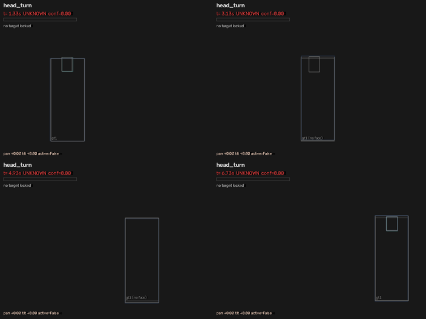
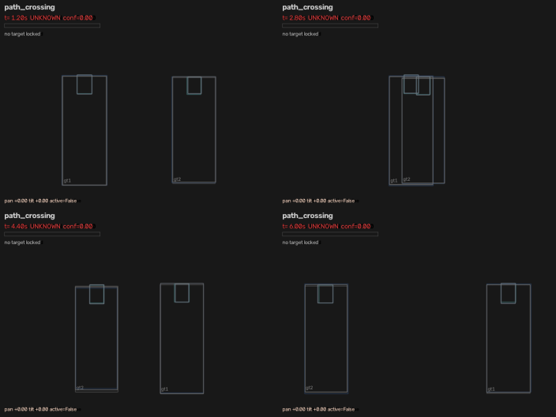
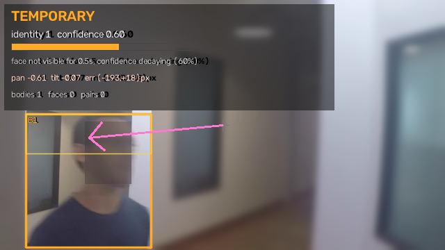

# Whole-person tracking with honest face-association identity continuity

A CPU-only Python module that follows **one chosen person** with a webcam or a
video file and keeps a **stable temporal identity** for them while their face is
temporarily unavailable — head turns, occlusions, detection misses, people
walking in front, paths crossing.

The design rule is honesty: the module is allowed to say *"these are probably
the same person, but I cannot verify it"*, and it is allowed to say *"I do not
know"*. It is not allowed to quietly pretend either.

```
                             bodies (YOLO, COCO person)
   frame ──► object detection ─────────────────────────────┐
                    │                                      │
                    └─► faces (YuNet + 5 landmarks) ──┐    │
                                                      ▼    ▼
                                            spatial face→body mapping
                                             (head band, midline, scale,
                                              Hungarian assignment)
                                                      │
                                                      ▼
                                  ┌────────────────────────────────┐
                                  │  identity ledger               │
                                  │  CONFIRMED ⇄ TEMPORARY ⇄ UNKNOWN│
                                  │  exponential confidence decay  │
                                  └────────────────────────────────┘
                                                      │
                                                      ▼
                                             target centring
                                        (dead-zone, gain, slew limit)
```

---

## Quick start

```bash
python -m venv .venv
.venv/Scripts/python -m pip install -r requirements.txt      # Windows
# .venv/bin/python -m pip install -r requirements.txt        # Linux / macOS

python scripts/download_models.py        # YOLOv8n + YuNet ONNX into models/

python scripts/run_demo.py --source 0                          # mirrored webcam
python scripts/run_demo.py --source data/videos/walking.mp4    # video file
```

The first demo run downloads InsightFace's `buffalo_l` recognition model pack
into `models/insightface/` if it is not already present. For first enrollment,
stand alone in view, wait for automatic face confirmation, press `e`, and type
your name. The name and ArcFace embeddings are stored locally in
`reports/arcface_enrollments.json`. On later runs, automatic locking waits for
an enrolled face to match; it does not auto-lock an unidentified visitor. The
name and confirmation state appear on the locked person's frame.

InsightFace's supplied pretrained model weights are licensed for
non-commercial research use only; separate permission is needed for commercial
use. Face embeddings are biometric data, so the registry is kept in a local,
git-ignored file. Face recognition reduces mistaken locks but cannot guarantee
zero false matches; ambiguous or weak matches should be treated cautiously.

Webcam input is mirrored by default so moving left/right matches what you see
on screen. Use `--no-mirror` to disable it; use `--mirror` to mirror a video
file too. Click a person to lock onto them; `u` unlocks, `s` snapshots, and
`q` quits.

Everything runs on the CPU. There is no GPU code path and no cloud call.

---

## The problem this solves

A face detector sees a face only while the face is pointed at the camera. A
person tracker sees the *body* almost all the time. Between those two facts
there is a gap, and naive systems fill it in one of two dishonest ways:

1. **Keep the identity claim alive forever.** The robot follows a stranger
   after the target has left, confidently.
2. **Drop the identity the moment the face is gone.** The robot forgets the
   person it was following the first time they turn their head.

The three-state model makes the gap explicit, and makes the cost of filling it
visible as a number.

---

## The three-state model

| State | Meaning | Entry condition |
|---|---|---|
| `CONFIRMED` | *This is the person I am following.* | live body track **and** a face observed within `freshness_window` (0.5 s) **and** confidence ≥ `confirm_threshold` (0.70) |
| `TEMPORARY` | *Probably the same person. Not verified right now.* | body still tracked (or lost < `body_grace_seconds`) **and** confidence ≥ `unknown_threshold` (0.25) |
| `UNKNOWN` | *I cannot say who this is.* | confidence below the floor, body lost beyond the grace period, or the association was ambiguous |

A body alone can **never** produce `CONFIRMED`. Only a fresh face observation
tied to that body can. That single rule is what keeps the model honest.

### Exponential confidence decay

Between face observations the belief is carried by a time-based decay:

```
c(t) = c₀ · exp( −(t − t₀) / τ )        τ = decay_tau (default 2.0 s)
                                        half-life = τ·ln2 = 1.39 s
```

Decay is measured in **seconds, not frames**, so behaviour is identical at
15 fps and 60 fps, and a stall in the pipeline does not silently freeze the
belief. `identity/states.py` implements it with no dependencies beyond `math`.

### State transitions

```
                    face observed on body
        UNKNOWN ─────────────────────────────► CONFIRMED
           ▲                                   │      ▲
           │ c < unknown_threshold             │      │ face returns
           │  or body lost                   face lost │
           ▼                                   ▼      │
        TEMPORARY ◄────────────────────────────┘      │
           └──────────────────────────────────────────┘
```

### Four decisions that matter

**Snap on re-acquisition, smooth when continuous.** While a face is being
observed every frame, confidence is exponentially smoothed (stability). When a
face reappears after a gap, confidence snaps to the quality of the new
observation, because that observation is a direct measurement rather than an
extrapolation. This is why recovery is immediate instead of a slow ramp.

**`freshness_window` bounds the smoothing cost.** A face that vanished keeps
the claim at most `freshness_window` (0.5 s) — the module measured a maximum
CONFIRMED hold of **0.37–0.50 s** after the face disappeared across all
scenarios. Any longer gap is `TEMPORARY`'s job, and `TEMPORARY` says so.

**Ambiguity is refused, not resolved.** If the two best bodies for one face
score within `ambiguity_margin` (0.08), the match is discarded. During a
crossing this is what prevents a face from being used as evidence for the
wrong person.

**Appearance conflicts break the link.** If a body that has been followed for
at least three face observations suddenly presents a very different appearance
descriptor (cosine similarity < 0.35), the tracker has almost certainly swapped
people. The identity is unbound and demoted to `UNKNOWN` instead of confirming
a stranger.

### Tunable surface

All parameters live in [`bodyfollowing/config.py`](bodyfollowing/config.py).
The identity block is the interesting one:

| Parameter | Default | Effect |
|---|---|---|
| `decay_tau` | 2.0 s | how long a hypothesis survives without evidence |
| `confirm_threshold` | 0.70 | confidence needed to assert an identity |
| `unknown_threshold` | 0.25 | floor below which no claim is made |
| `freshness_window` | 0.5 s | how long a face observation stays "current" |
| `body_grace_seconds` | 1.5 s | how long a lost body keeps `TEMPORARY` alive |
| `retire_after` | 8.0 s | when a lost identity is deleted |

---

## Spatial face-to-body mapping

A face on a standing person is not free-floating: it sits in the **head band**
at the top of the body box, near the body midline, at a size proportional to
the body's height. `association/face_body.py` turns those three facts into a
score in `[0, 1]`:

| Term | Weight | What it enforces |
|---|---|---|
| vertical | 0.34 | face centre inside the top 32 % of the body box |
| horizontal | 0.22 | face centre near the body midline (Gaussian falloff) |
| scale | 0.20 | face height ≈ 17 % of body height, compared in log space |
| overlap | 0.24 | fraction of the face box inside the body box |

Faces are then assigned one-to-one with the Hungarian algorithm, padded with
dummy columns so that **refusing to match is always an option**. A pure-numpy
solver is bundled and unit-tested against brute force, so the package works
without SciPy; SciPy is used when present.

Two honesty signals come out of every match:

* **contamination** — how much of the face is covered by *another* body. When
  somebody walks in front of the target, the visible face belongs to the
  occluder; using it as evidence for the target would be a lie.
* **ambiguous** — the runner-up body scored within the margin. Two people
  crossing at the same depth produce this; refusing to decide is the correct
  behaviour.

---

## Target centring

`control/centering.py` converts "where the target is" into a normalised
pan/tilt command in `[-1, 1]`:

* aim at the **face** when `CONFIRMED`, otherwise at the upper body (avoiding
  the lurch that centring on feet causes when a person approaches);
* **dead-zone** on the normalised error (6 % horizontal, 8 % vertical) so a
  stationary person does not make a gimbal jitter;
* proportional gain, error smoothing and a **slew limit** so one bad detection
  cannot whip the camera;
* **never chase an `UNKNOWN` target.** When the identity model is unsure, the
  controller holds position and says why. Chasing a look-alike is how a robot
  loses the person it was following.

`+pan` means "pan right", `+tilt` means "tilt up", both normalised, so the
output drops straight into a servo loop or a simulated gimbal.

---

## Evaluation without hardware

Two independent harnesses are included, because they answer different
questions.

### 1. Scripted detector-level scenes (exact ground truth)

[`sources/simulated.py`](bodyfollowing/sources/simulated.py) generates a
**detector-level observation stream**: actors walk with constant velocity,
turn their heads away, get occluded by a nearer actor, and cross paths. On top
of that sits a realistic imperfection model — box jitter, random detector
misses, and the failure that actually causes identity swaps: **two overlapping
people being fused into a single detection**.

Every actor carries a ground-truth id, so a `CONFIRMED` claim can be scored
against what was actually true.

### 2. Real-pixel composited scenes (real appearance + exact ground truth)

[`sources/composited.py`](bodyfollowing/sources/composited.py) lifts real
people out of a real video, re-stages them on a canvas, and scripts the
choreography on top: a head turn is rendered by covering the face region while
the body stays intact, an occlusion is a second real person walking in front,
and a crossing is two real people swapping sides. The **real** detector then
runs on those pixels, and the ground truth is still exact because the canvas is
generated.

### Metrics

| Metric | Why it exists |
|---|---|
| `confirmed_precision` | of the frames claimed `CONFIRMED`, how many were the right person |
| `wrong_person_frames` | frames where the module pointed at somebody else |
| `identity_switches` | how often the claimed person changed |
| `temporary_episodes` | identity carried through a gap in face evidence |
| `recovery_mean_s` | seconds from the face returning to `CONFIRMED` |
| `confirmed_hold_after_face_loss_s` | how long `CONFIRMED` survived after the face vanished |
| `state_fraction_post_lock` | time spent in each state, excluding the pre-lock warm-up |
| `centring_active_rate` | how often the controller was willing to drive the camera |

Track-to-ground-truth labelling is **stable**: each tracker id is labelled once,
at an unambiguous moment, and keeps that label. Grading with a per-frame IoU
match would flip while two people overlap and blame the tracker for a
measurement artefact.

---

## Results

`python scripts/run_scenarios.py --figures --sweep-decay --seeds 5`

### Identity continuity by scenario

Starred columns exclude the ~1 s warm-up before the user selects a target.

| Scenario | Confirmed* | Temporary* | Unknown* | Conf. precision | Wrong-person frames | ID switches | Recovery | Centring active |
|---|---|---|---|---|---|---|---|---|
| head_turn | 77 % | 23 % | 0 % | 1.00 | 0 | 0 | ≤1 frame | 88 % |
| occlusion | 93 % | 7 % | 0 % | 1.00 | 0 | 0 | ≤1 frame | 88 % |
| path_crossing | 96 % | 3 % | 0 % | 1.00 | 0 | 0 | n/a (no face loss) | 87 % |
| long_absence | 44 % | 22 % | 34 % | 1.00 | 0 | 0 | ≤1 frame | 60 % |
| combined | 67 % | 32 % | 0 % | 1.00 | 0 | 0 | ≤1 frame | 91 % |

Across **5 scenarios × 5 detector-noise seeds = 25 runs, all 25 pass** their
specified expectations (`reports/robustness.json`). No run ever confirmed the
wrong person.

### What a real trajectory looks like

`head_turn` — the face turns away at 3.0 s and returns at 5.2 s:

| Window | State | Mean confidence |
|---|---|---|
| 0.00 – 1.03 s | `unknown` | 0.00 (no target selected yet) |
| 1.03 – 3.50 s | `confirmed` | 0.92 |
| 3.50 – 5.23 s | `temporary` | 0.48 ← face gone, identity carried |
| 5.23 – 8.90 s | `confirmed` | 0.93 ← recovered, same identity id |
| 8.90 – 8.97 s | `temporary` | 0.69 (target leaving the frame) |

`long_absence` — the face is hidden for 6 s, and the model is honest about it:

| Window | State | Mean confidence |
|---|---|---|
| 1.03 – 2.47 s | `confirmed` | 0.92 |
| 2.47 – 4.67 s | `temporary` | 0.46 |
| 4.67 – 8.03 s | `unknown` | 0.12 ← no claim is made |
| 8.03 – 10.97 s | `confirmed` | 0.93 ← same identity id, re-confirmed |

Note that centring is deliberately inactive during the `unknown` stretch,
which is why that scenario's centring rate is 60 % rather than ~90 %.

### The decay curve matches theory

`python scripts/run_scenarios.py --sweep-decay` measures the time from face
loss to the `UNKNOWN` transition and compares it with the closed form
`τ·ln(c₀/unknown_threshold)`:

| τ (s) | half-life (s) | measured (s) | predicted (s) | error (s) |
|---|---|---|---|---|
| 0.5 | 0.35 | 0.60 | 0.59 | 0.01 |
| 1.0 | 0.69 | 1.30 | 1.27 | 0.03 |
| 2.0 | 1.39 | 2.67 | 2.65 | 0.02 |
| 4.0 | 2.77 | 5.43 | 5.40 | 0.03 |
| 8.0 | 5.55 | 10.93 | 10.91 | 0.02 |

The residual is one frame period. The implementation is the equation.

### Real pixels, real detector, exact ground truth

`python scripts/composite_scene.py --video data/videos/walking.mp4`

Two real people are lifted out of a 768×432 clip, re-staged on a canvas and
fed to the **actual** YOLOv8n + YuNet stack. Same metrics, real appearance:

| Composite scenario | Confirmed* | Temporary* | Unknown* | Conf. precision | Wrong-person frames | ID switches | Recovery | Centring active |
|---|---|---|---|---|---|---|---|---|
| head_turn | 70 % | 29 % | 1 % | 1.00 | 0 | 0 | ≤1 frame | 85 % |
| occlusion | 76 % | 24 % | 1 % | 1.00 | 0 | 0 | 0.03 s | 82 % |
| path_crossing | 81 % | 19 % | 1 % | 1.00 | 0 | 0 | 0.03 s | 84 % |
| combined | 61 % | 36 % | 3 % | 1.00 | 0 | 0 | ≤1 frame | 84 % |

Every check passes, and `confirmed_precision` stays at 1.00 — the module never
asserted the wrong person on real pixels.

### Real video, no labels

`python scripts/evaluate_video.py --video data/videos/walking.mp4 --max-frames 300`

An unlabelled clip cannot measure accuracy, but it can show the model
transitioning for real. Auto-lock (no user click) on a 25 s clip:

| Window | State | Identity | Mean confidence |
|---|---|---|---|
| 0.0 – 3.8 s | `unknown` | – | 0.00 |
| 3.9 – 9.3 s | `confirmed` | 1 | 0.89 |
| 9.3 – 11.3 s | `temporary` | 1 | 0.44 ← face lost, identity carried |
| 11.3 – 20.7 s | `unknown` | 1 | 0.05 ← person gone, no claim made |
| 20.8 – 24.9 s | `confirmed` | 3 | 0.90 ← a new face-verified person |

Consistency statistics for that run: **91.5 %** of detected faces were tied to
a body, 1 identity per confirmed person, centring active 47 % of the time
(inactive exactly while the state was `unknown`).

### Figures

Simulated `head_turn`: the state is `TEMPORARY`, the identity id is preserved,
confidence is decaying and the centring arrow still points at the target.



Path crossing between two people at the same depth:



Real pixels, real detector, mid head-turn — the face is gone, the body is not,
and the module says exactly that:



### Throughput on the reference CPU

Measured end-to-end, one frame at a time, no batching (YOLOv8n + YuNet +
tracking + identity + centring), on a mid-range laptop CPU:

| Stage | Latency |
|---|---|
| YOLOv8n person, `imgsz=640` | 312 ms |
| YOLOv8n person, `imgsz=480` (default) | 212 ms |
| YOLOv8n person, `imgsz=320` | 172 ms |
| YuNet faces + landmarks | 150 ms |
| **Full pipeline, 768×432 video** | **~420 ms ⇒ 2.4 fps** |

This is the honest ceiling for this CPU: ~2–3 fps with the default settings.
The levers, in order of effect, are `detector.img_size`, `detector.face_every`
(detect faces every Nth frame) and running the tracker on a downscaled frame.
The Kalman motion model keeps the centring command continuous between
detections, so 2–3 fps does not produce a stuttering camera — but it is not a
30 fps system and the README will not pretend otherwise.

---

## Honest limitations

* **The kinematic harness simulates detections, not pixels.** It gives exact
  ground truth and controlled failure modes, but its appearance descriptors are
  synthetic. Real-appearance behaviour is covered by the composited scenes and
  the real-video run.
* **The composited scenes are re-staged, not filmed.** They use real people and
  the real detector, but the canvas is generated; hard sprite edges are not
  something a camera produces.
* **No physical gimbal is driven.** The controller emits normalised commands;
  it does not model servo latency, backlash or inertia.
* **Face recognition can still make mistakes.** ArcFace compares facial
  embeddings and refuses matches below its similarity threshold or near a
  competing enrolled identity, but it cannot guarantee zero false matches.
* **`CONFIRMED` can outlive the last face by up to `freshness_window`.** That
  is a measured 0.37–0.50 s of smoothing, reported explicitly as
  `confirmed_hold_after_face_loss_s` rather than hidden.
* **Single-target.** One identity is followed at a time; other people are
  tracked and given their own ids, but only the locked target is centred.

---

## Layout

```
bodyfollowing/
  types.py              Box, Detection, tracks, Identity, claim, command
  config.py             every tunable in one place
  pipeline.py           frame in → claim + centring command out
  perception/           YOLO person detector, YuNet face detector, descriptors
  tracking/             Kalman, SORT-style body tracker, face tracker, motion gate
  association/          spatial face→body mapping + Hungarian assignment
  identity/             the three-state model (states.py, manager.py)
  control/              target centring controller
  sources/              webcam/video, kinematic simulator, composited scenes
  evaluation/           ground-truth metrics, checks, reports, overlays
scripts/                download_models, run_demo, run_scenarios, evaluate_video,
                        composite_scene
tests/                  98 unit and integration tests
reports/                generated results (JSON + Markdown + figures)
```

## Commands

```bash
# unit + integration tests
python -m pytest tests -q

# scripted scenarios, figures, decay sweep, seed robustness
python scripts/run_scenarios.py --figures --sweep-decay --seeds 5

# real video: real frames, real detector, consistency statistics (no GT)
python scripts/evaluate_video.py --video data/videos/walking.mp4

# real pixels with exact ground truth, re-staged from real people
python scripts/composite_scene.py --video data/videos/walking.mp4

# live webcam
python scripts/run_demo.py --source 0
```

A sample clip can be fetched with:

```bash
mkdir -p data/videos && curl -L -o data/videos/walking.mp4 \
  https://raw.githubusercontent.com/intel-iot-devkit/sample-videos/master/face-demographics-walking.mp4
```
